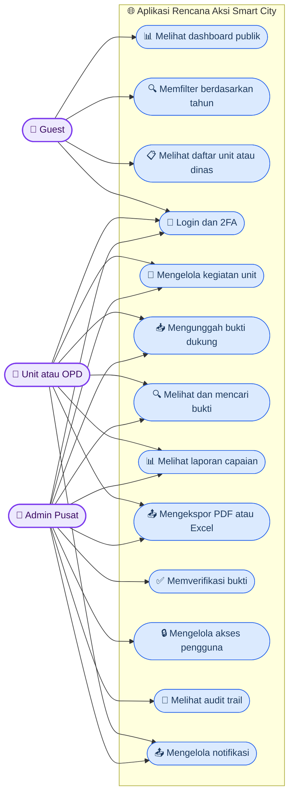
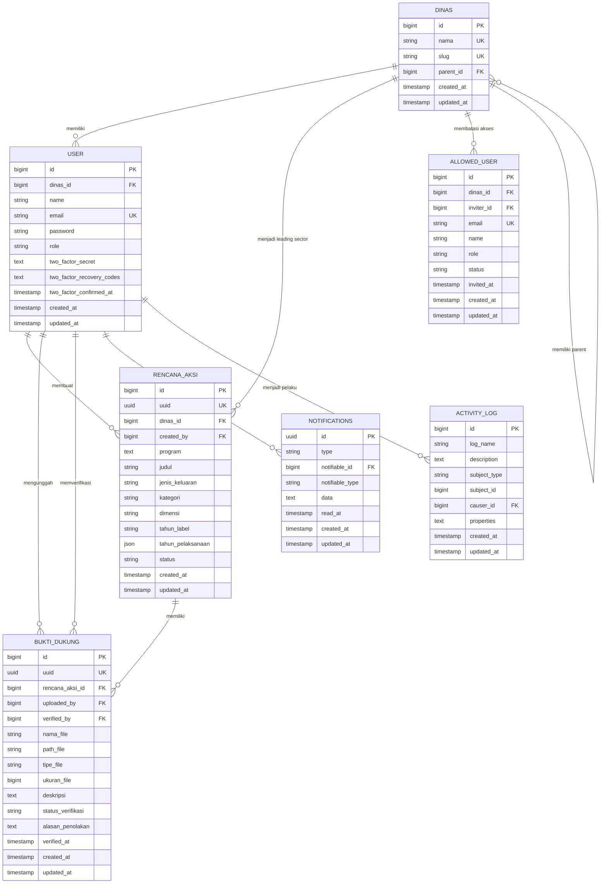
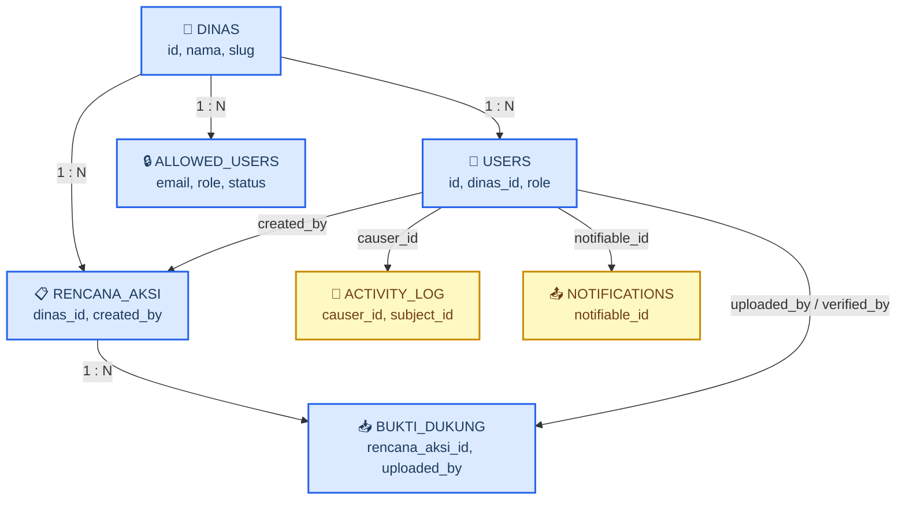
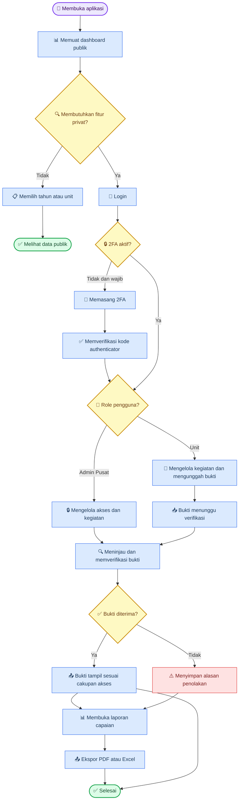

# Diagram sistem Rencana Aksi Smart City

_Dokumentasi struktur fitur, database, relasi data, dan alur utama aplikasi._

---

## 📋 Use case sistem

Diagram berikut menunjukkan kapabilitas berdasarkan aktor Guest, Unit/OPD, dan Admin Pusat.

> Guest hanya mengakses data publik. Detail kegiatan, pencarian bukti, dan bukti dukung memerlukan autentikasi sesuai kebijakan aplikasi.

## 🗃️ ERD database

ERD ini menggambarkan tabel domain utama dan tabel pendukung autentikasi, notifikasi, serta audit.

## 🔗 Relasi database

Relasi berikut menekankan arah dependensi data domain utama.

## 🔄 Flowchart alur utama

Flowchart ini menunjukkan alur pengguna dari membuka aplikasi sampai membaca dashboard, login, mengelola bukti, dan menghasilkan laporan.

## 📚 Sumber struktur

Diagram disusun berdasarkan:

- migration pada `database/migrations/`;
- model dan relasi Eloquent pada `app/Models/`;
- route API pada `routes/api.php` dan route web pada `routes/web.php`;
- policy dan middleware autentikasi/otorisasi;
- feature test pada `tests/Feature/`.
